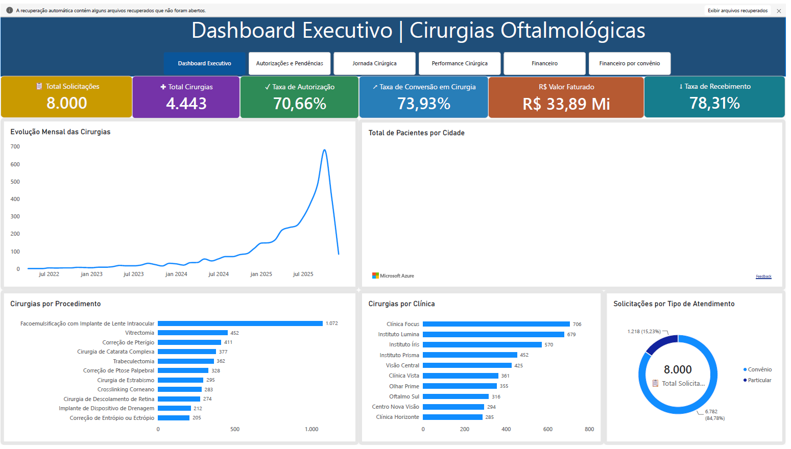
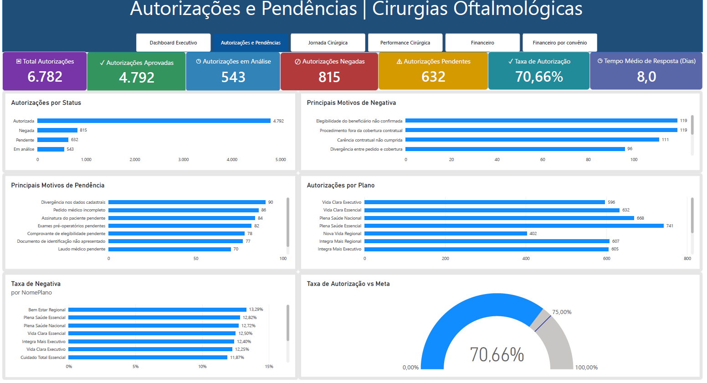
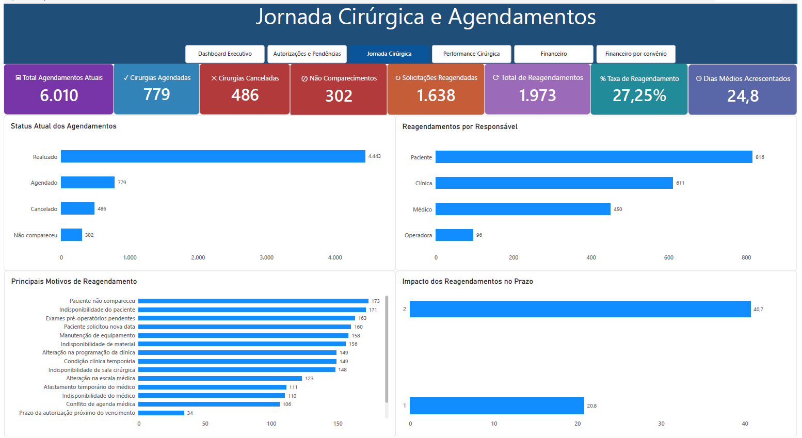

📈 **Página 1 - Dashboard Executivo**

Visão consolidada dos principais indicadores da operação.

Principais análises:

Total de solicitações
Total de cirurgias realizadas
Taxa de autorização
Taxa de conversão em cirurgia
Valor faturado
Taxa de recebimento
Evolução mensal das cirurgias
Distribuição geográfica dos pacientes
Cirurgias por procedimento
Cirurgias por clínica
Distribuição entre convênio e particular

 

 --- 
 ## 📋 Página 2 - Autorizações e Pendências

Análise do processo de autorização das solicitações enviadas aos convênios.

Principais análises:

Total de autorizações
Autorizações aprovadas
Autorizações negadas
Autorizações pendentes
Autorizações em análise
Taxa de autorização
Tempo médio de resposta
Principais motivos de negativa
Principais motivos de pendência
Autorizações por convênio
Taxa de autorização versus meta

  

 --- 
 ## 📅 Página 3 - Jornada Cirúrgica e Agendamentos

Acompanhamento da jornada entre liberação, agendamento e realização da cirurgia.

Principais análises:

Total de agendamentos atuais
Cirurgias agendadas
Cirurgias canceladas
Não comparecimentos
Solicitações reagendadas
Total de eventos de reagendamento
Taxa de reagendamento
Dias médios acrescentados à jornada
Reagendamentos por responsável
Principais motivos de reagendamento
Impacto dos reagendamentos no prazo

  

 --- 
 ##⚕️ Página 4 - Performance Cirúrgica

Visão operacional das cirurgias efetivamente realizadas.

Principais análises:

Total de cirurgias
Duração média prevista
Duração média realizada
Desvio médio de duração
Atraso médio de início
Cirurgias dentro do tempo previsto
Taxa de aderência ao tempo previsto
Ocorrências operacionais
Duração prevista versus realizada por procedimento
Atraso médio por clínica
Performance por médico

  

 --- 
 ##💰 Página 5 - Financeiro Cirúrgico

Análise consolidada do desempenho financeiro das cirurgias realizadas.

Principais análises:

Valor faturado
Valor recebido
Saldo a receber
Custo total
Margem prevista
Margem realizada
Composição do faturamento até o recebimento
Saldo a receber por convênio
Valor glosado por motivo
Valor glosado por convênio
Margem prevista versus realizada por procedimento
Margem realizada por clínica

  

 --- 
 ##🏦 Página 6 - Financeiro por Convênio

Visão específica da performance financeira das operadoras de saúde.

Principais análises:

Valor faturado aos convênios
Valor recebido dos convênios
Saldo a receber
Valor glosado
Taxa de recebimento
Taxa de glosa
Faturado versus recebido por convênio
Saldo a receber por convênio
Taxa de glosa por convênio
Valor glosado por convênio
Faturamento versus taxa de recebimento
Detalhamento financeiro por convênio

  

 --- 
 ## 📌 Indicadores de Destaque

Alguns dos principais resultados apresentados no dashboard:

8.000 solicitações cirúrgicas
4.443 cirurgias realizadas
70,66% de taxa de autorização
73,93% de conversão em cirurgia
27,25% de taxa de reagendamento
24,8 dias médios acrescentados nos casos reagendados
78,03% das cirurgias dentro do tempo previsto
R$ 33,89 milhões faturados
R$ 26,54 milhões recebidos
R$ 6,81 milhões de saldo a receber
78,31% de taxa de recebimento

 --- 
 ##🧠 Principais Aprendizados

O desenvolvimento deste projeto permitiu trabalhar conceitos importantes de Business Intelligence, incluindo:

Definição de granularidade das tabelas fato
Construção de modelo dimensional
Relacionamentos ativos e inativos no Power BI
Uso de dimensão calendário com múltiplos papéis de data
Construção de medidas DAX
Uso de USERELATIONSHIP em análises temporais
Criação e análise de indicadores de jornada
Desenvolvimento de KPIs financeiros
Análise de glosas e contas a receber
Construção de dashboards executivos e operacionais
Organização visual e storytelling com dados
📄 Relatório Completo

O relatório completo exportado em PDF está disponível neste projeto:

dashboard_cirurgias_oftalmologicas.pdf

 --- 
 ## 📁 Estrutura do Projeto

Dashboard-Cirurgias-Oftalmologicas/

Imagens/
README.md
dashboard_cirurgias_oftalmologicas.pdf
👤 Autor

Projeto desenvolvido para fins de estudo, prática profissional e composição de portfólio em Business Intelligence e Data Analytics.
