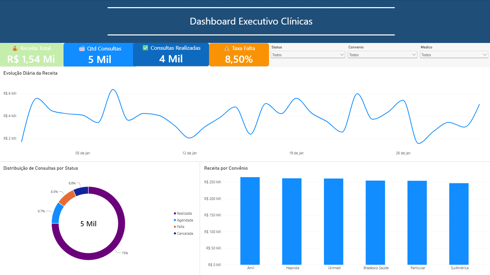
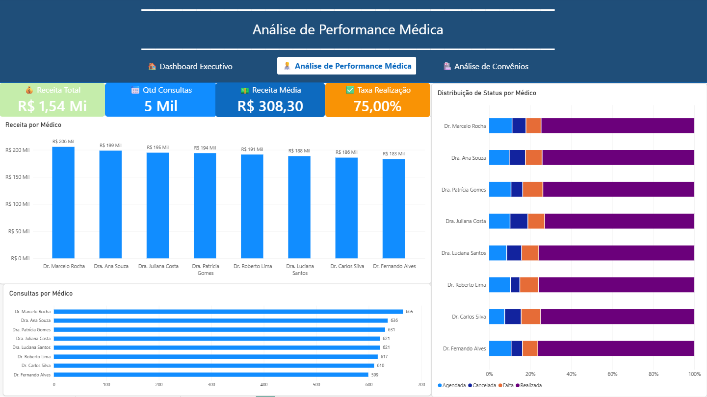
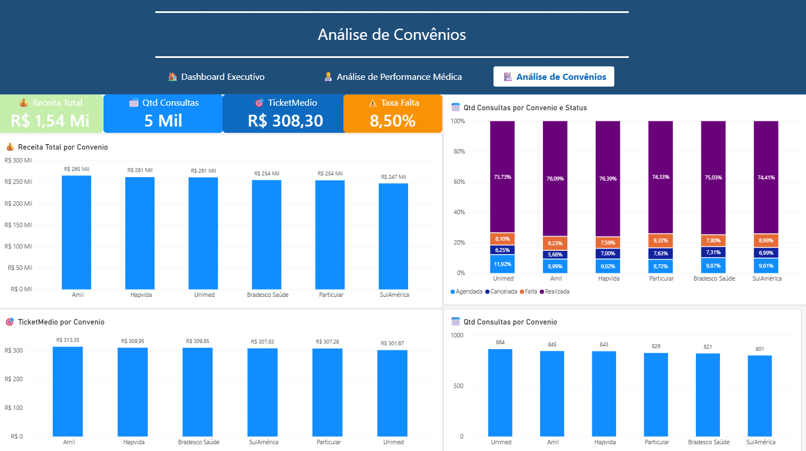

# Dashboard de Clínica

Projeto desenvolvido com Power BI, Python, Excel, DAX e Power Query.

## Tecnologias Utilizadas

- Power BI
- DAX
- Power Query
- Python
- Excel

## Páginas

## Dashboard Executivo

## Análise de Performance Médica

## Análise de Convênios

## Arquivo do Projeto

📄 [Dashboard_Clinica.pdf](Dashboard_Clinica.pdf)
